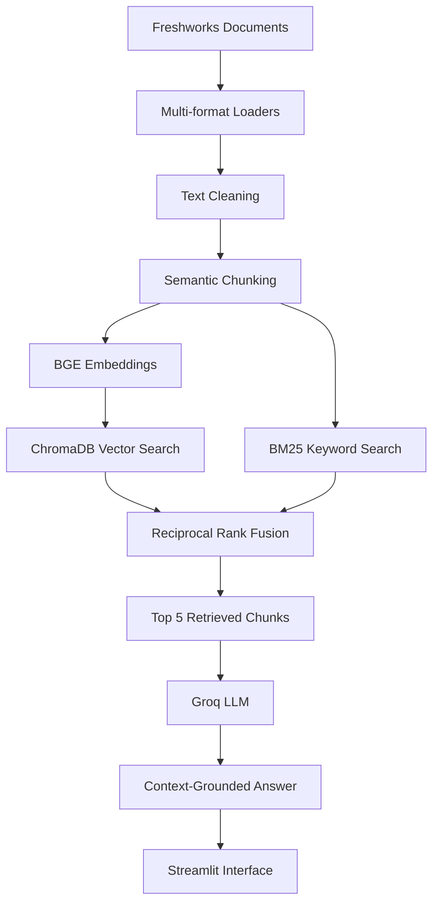

# ARVON AI — Freshworks RAG Chatbot

<p align="center">
  
</p>

<p align="center">
  <strong>A document-grounded AI assistant for Freshworks knowledge.</strong>
</p>

<p align="center">
  <a href="https://arvon-ai-aryanhajaria.streamlit.app/"><strong>Live Demo</strong></a> •
  <a href="https://github.com/AryanHajaria2003/ARVON-AI"><strong>Source Code</strong></a>
</p>

---

## Overview

**ARVON AI** is a Retrieval-Augmented Generation (RAG) chatbot that answers questions using a dedicated collection of Freshworks documents.

The application combines semantic vector search, keyword-based retrieval, and Reciprocal Rank Fusion (RRF) to identify relevant information. The retrieved document chunks are passed to a Groq-hosted large language model to generate concise, context-grounded responses through an interactive Streamlit interface.

This project demonstrates an end-to-end RAG workflow, from document preprocessing and indexing to hybrid retrieval, answer generation, and evaluation.

## Features

- **Multi-format document ingestion** — Supports PDF, HTML, and DOCX files.
- **Text cleaning** — Preprocesses extracted content before indexing.
- **Semantic chunking** — Divides documents into meaningful chunks.
- **BGE embeddings** — Uses `BAAI/bge-base-en-v1.5`.
- **Vector search** — Stores and retrieves embeddings using ChromaDB.
- **Keyword search** — Uses BM25 for lexical retrieval.
- **Hybrid retrieval** — Combines retrieval rankings using Reciprocal Rank Fusion.
- **LLM-powered answers** — Uses Groq API with `openai/gpt-oss-120b`.
- **Interactive chatbot** — Provides a Streamlit interface with expandable source information.
- **Evaluation scripts** — Evaluates retrieval performance and generated answers separately.

## Live Demo

Try the deployed application:

**[Launch ARVON AI](https://arvon-ai-aryanhajaria.streamlit.app/)**

Ask questions about Freshworks financial results, products, AI capabilities, and other topics covered by the indexed documents.

## Architecture



## Technology Stack

| Component | Technology |
|---|---|
| Language | Python |
| Frontend | Streamlit |
| RAG framework | LangChain |
| Embedding model | `BAAI/bge-base-en-v1.5` |
| Vector database | ChromaDB |
| Keyword retrieval | BM25 |
| Ranking strategy | Reciprocal Rank Fusion (RRF) |
| LLM provider | Groq |
| Generation model | `openai/gpt-oss-120b` |
| Evaluation | Custom Python scripts |

## Project Structure

```text
ARVON-AI/
├── app.py                  # Streamlit application
├── Rag_pipeline.py         # RAG answer generation
├── retrieval.py            # Hybrid retrieval and RRF
├── retrieval_evaluation.py # Retrieval evaluation
├── evaluation.py           # Generation evaluation
├── database_check.py       # Database verification
├── test_retrieval.py       # Retrieval tests
├── RG(MAIN).PY             # Main/experimental pipeline
├── requirements.txt        # Python dependencies
├── README.md               # Project documentation
├── chroma_db/              # Persisted vector database
└── chunks.pkl              # Serialized document chunks
```

The original source-document collections and local API secrets are excluded from version control. The prepared vector database and serialized chunks are included for the current deployment.

## Getting Started

### Prerequisites

- Python
- Git
- A Groq API key
- The prepared RAG knowledge base or the source documents required to build it

### 1. Clone the repository

```bash
git clone https://github.com/AryanHajaria2003/ARVON-AI.git
cd ARVON-AI
```

### 2. Create a virtual environment

**Windows PowerShell**

```powershell
python -m venv .venv
.\.venv\Scripts\Activate.ps1
```

### 3. Install dependencies

```bash
python -m pip install --upgrade pip
pip install -r requirements.txt
```

### 4. Configure the API key

Create a file named `.streamlit/secrets.toml` in the project root:

```toml
GROQ_API_KEY = "your_groq_api_key"
```

Get your API key from the [Groq Console](https://console.groq.com/keys).

Never commit API keys or secret configuration files to version control.

### 5. Verify the knowledge base

Ensure the `chroma_db/` directory and `chunks.pkl` file are available in the project root. The retrieval pipeline depends on these files.

If you are building a new knowledge base, prepare and index the Freshworks documents before running the chatbot.

### 6. Launch the application

```bash
streamlit run app.py
```

Open the local URL printed in the terminal, typically `http://localhost:8501`.

## How It Works

### 1. Document ingestion

PDF, HTML, and DOCX files are loaded and their text is extracted.

### 2. Cleaning and chunking

Extracted text is cleaned and divided into semantically meaningful chunks to improve retrieval.

### 3. Embedding and indexing

The BGE embedding model converts document chunks into vector representations stored in ChromaDB. The chunk collection is also used by BM25 for keyword-based retrieval.

### 4. Hybrid retrieval

ChromaDB retrieves semantically similar content, while BM25 finds keyword-relevant passages. Reciprocal Rank Fusion combines their rankings.

The RRF score is calculated as:

\[
\operatorname{RRF}(d)=\sum_{r \in R(d)}\frac{1}{k+r(d)}
\]

Here, \(r(d)\) is the rank of a document in a retrieval result, and \(k\) is the ranking constant. The implementation uses \(k=60\).

### 5. Answer generation

The highest-ranked chunks are supplied as context to the Groq-hosted LLM. The prompt instructs the model to answer using the supplied documents and acknowledge when the required information is unavailable.

### 6. Evaluation

Separate scripts test retrieval behavior and answer generation.

## Evaluation

Run retrieval evaluation:

```bash
python retrieval_evaluation.py
```

Run answer-generation evaluation:

```bash
python evaluation.py
```

The scripts use predefined questions, expected answer terms, and relevance checks to assess different parts of the pipeline.

**Evaluation note:** Keyword-based checks are approximate. A failed keyword check does not always indicate an incorrect answer, and a passing check does not guarantee factual accuracy. Review generated answers alongside the retrieved chunks for a more reliable assessment.

## Limitations

- Answer quality depends on the coverage and relevance of the indexed documents.
- Questions outside the available knowledge base may not be answerable.
- Context-grounding instructions reduce unsupported answers but cannot eliminate hallucinations.
- Keyword-based evaluation does not fully measure factual accuracy, completeness, or faithfulness.
- Local execution requires compatible dependencies, the Groq API key, and the knowledge-base files.
- The application depends on third-party services and their availability.

## Security and Data Handling

- API credentials are configured through Streamlit Secrets or local secret files.
- Local secrets and original source-document folders are excluded from Git.
- The prepared ChromaDB and serialized chunks are currently included in the public repository. They may contain extracted document text, so verify redistribution permissions before sharing the repository or its knowledge base.

## Future Improvements

- Expand and regularly update the document corpus.
- Improve retrieval quality using manually verified relevance labels.
- Evaluate answer faithfulness, citation accuracy, and completeness.
- Improve handling of tables, metadata, and multi-document questions.
- Pin and test dependency versions for reproducible deployment.
- Optimize retrieval latency and resource usage.

## Author

**Aryan Hajaria**

- **GitHub:** [AryanHajaria2003](https://github.com/AryanHajaria2003)
- **Project Repository:** [ARVON-AI](https://github.com/AryanHajaria2003/ARVON-AI)
- **Live Application:** [ARVON AI on Streamlit](https://arvon-ai-aryanhajaria.streamlit.app/)

---

<p align="center">
  Built with Python, LangChain, ChromaDB, and Groq.
</p>
